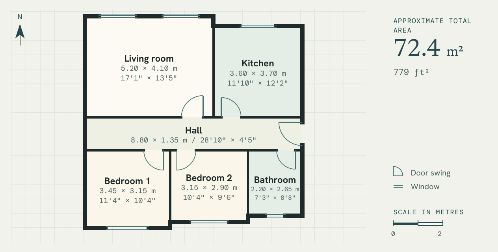
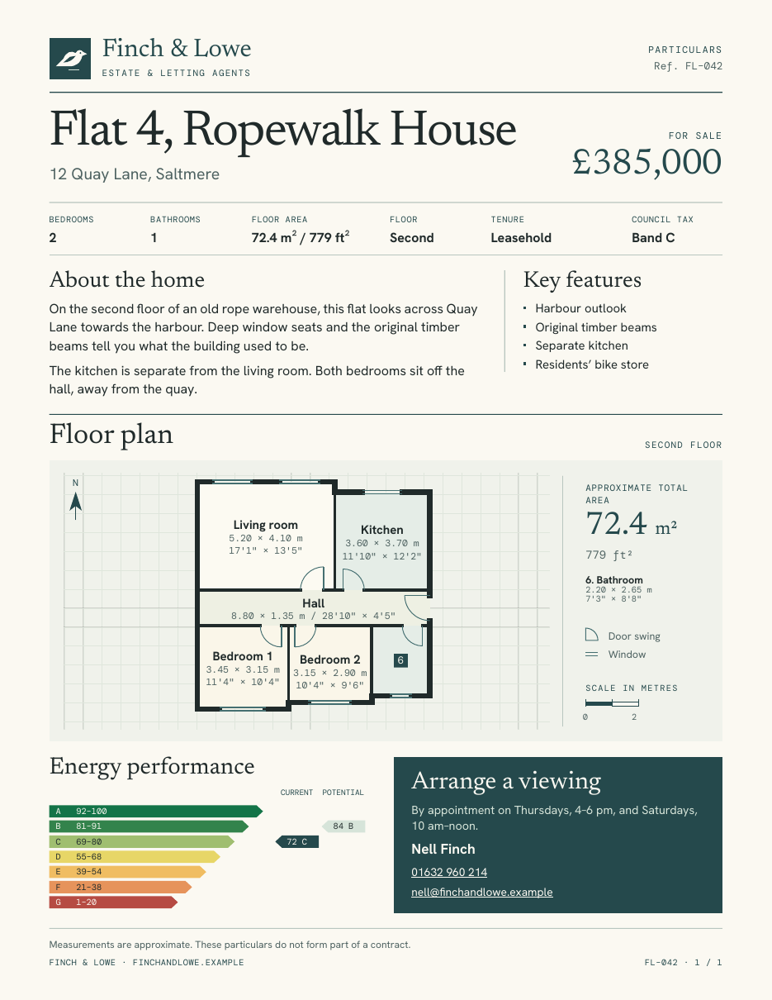
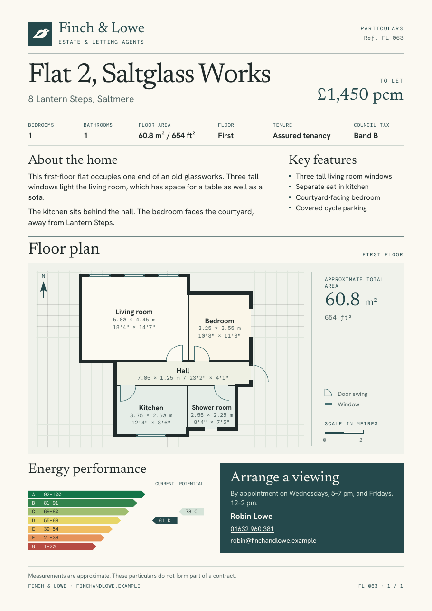

# Finch & Lowe listing sheet

**A Hyper Elements template for a home’s listing sheet: the floor plan drawn to scale from its rooms, each room’s size beside it, the floor area added up, and the energy rating as the familiar coloured bands.**

[](docs/ropewalk-house-a4.png)

A property team can use the same room measurements for the viewing handout, the email attachment and the portal PDF. The measurements draw the plan and add up to the floor area, so editing a room updates both.

## Use it

Install with Node and npm. Have `pdftoppm` from Poppler on your PATH for the page PNGs. The build fetches the PDF fonts from Google Fonts on its first run.

```sh
git clone https://github.com/adityasarade/hyper-elements-listing-sheet
cd hyper-elements-listing-sheet
npm ci
npm run build
```

The gallery component renders Ropewalk House by default. Pass a listing and a paper size to render it from TSX.

```tsx
import FinchLoweListingSheet, {
  ropewalk,
  type ListingValues,
} from "./src/finch-lowe-listing-sheet";

const values: ListingValues = { ...ropewalk, price: 390000 };
const sheet = <FinchLoweListingSheet values={values} size="Letter" />;
```

Copy the checked example, then edit a field with the CLI. The build renders both formats named in the values file into `out/`.

```sh
npx hyper-elements describe templates/listing-sheet.tsx
cp designs/ropewalk-house.values.json designs/my-listing.values.json
npx hyper-elements design set designs/my-listing.values.json price=390000
npm run build -- designs/my-listing.values.json
```

## How Hyper Elements is used

`Document.Page` holds the particulars. `PageFooter` repeats the agency, reference and page count. The print HTML and PDF use the same component. A longer listing can put the plan on a second sheet.

The plan uses `Svg` rectangles for rooms and walls, paired `Line`s for glazing and a `Path` arc for each door. Shared edges become partitions. `Layer` puts selectable text over the drawing. Small rooms get numbers keyed to their measurements in the margin. The EPC chart uses seven `Polygon` bands and places two arrows from the entered scores.

```ts
const area = rooms.reduce((sum, room) => sum + room.width * room.depth, 0);
const squareFeet = Math.round(area / 0.3048 ** 2);
```

The [template](templates/listing-sheet.tsx) limits copy length, feature count, room sizes, opening sizes and EPC scores. It checks for overlapping rooms, invalid openings and room counts that disagree with the plan. Its document rules require a language, allowed link schemes, and both horizontal and page overflow checks.

```ts
formats: { a4: { size: "A4" }, letter: { size: "Letter" } },
rules: {
  require: { core: ["layout/overflow", "document/overflow"] },
  root: { lang: true },
  links: { domains: ["finchandlowe.example"], schemes: ["mailto", "tel"] },
},
```

## Views

### The plan is the data

With north at the top, `x` increases east and `y` increases south. Each doorway or window names a room and wall, then gives its offset and width in metres. The six rooms below produce **72.4 m² (779 ft²)**.

<table>
<tr>
<th>Ropewalk House floor plan</th>
<th>Room values in metres</th>
</tr>
<tr>
<td valign="top"><a href="docs/ropewalk-plan-detail.png"></a></td>
<td valign="top"><pre>[
  {"name":"Living room", "kind":"living",
   "x":0, "y":0, "width":5.2, "depth":4.1},
  {"name":"Kitchen", "kind":"kitchen",
   "x":5.2, "y":0.4, "width":3.6, "depth":3.7},
  {"name":"Hall", "kind":"hall",
   "x":0, "y":4.1, "width":8.8, "depth":1.35},
  {"name":"Bedroom 1", "kind":"bedroom",
   "x":0, "y":5.45, "width":3.45, "depth":3.15},
  {"name":"Bedroom 2", "kind":"bedroom",
   "x":3.45, "y":5.45, "width":3.15, "depth":2.9},
  {"name":"Bathroom", "kind":"bathroom",
   "x":6.6, "y":5.45, "width":2.2, "depth":2.65}
]</pre></td>
</tr>
</table>

### A4 and Letter

Both paper sizes use the same [Ropewalk House values](designs/ropewalk-house.values.json). [Saltglass Works](designs/saltglass-works.values.json) is a one-bedroom rental with a stepped footprint, an outward-swinging entrance and a computed area of **60.8 m² (654 ft²)**.

| Ropewalk House · Letter | Saltglass Works · A4 |
| --- | --- |
| [](docs/ropewalk-house-letter.png) | [](docs/saltglass-works-a4.png) |

## Checks

| Command | Result |
| --- | --- |
| `npm run build` | 0 errors and warnings, 0 notes |
| `npx hyper-elements check templates designs` | 0 errors, 0 warnings, 0 skipped |
| `npx tsc --noEmit` | Exit 0 |

The CLI checks the template and values. The build script renders their PDFs through the ESM PDF renderer and writes a PNG for each page.

## Add it to the gallery

Copy `src/finch-lowe-listing-sheet.tsx` to `apps/website/examples/templates/`. It has the gallery’s `meta` and renders with no props.

## License

[MIT](LICENSE). Newsreader, Hanken Grotesk and DM Mono are from Google Fonts and licensed under the SIL Open Font License.
