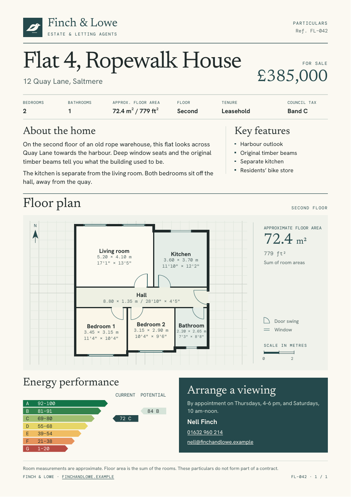
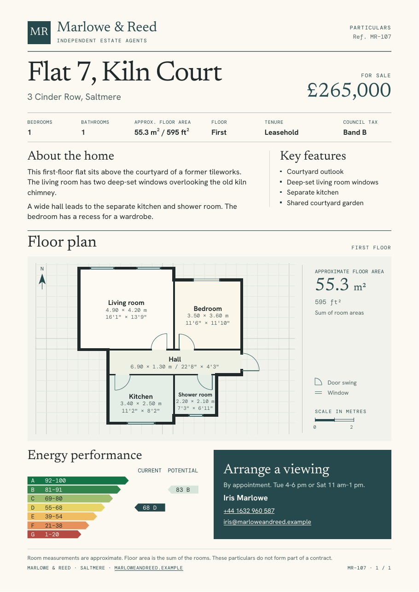
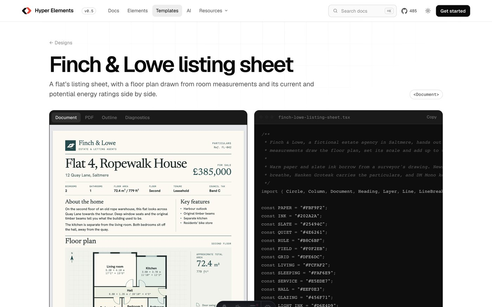

# Finch & Lowe listing sheet

**A Hyper Elements listing sheet with a floor plan drawn to scale from its rooms, their dimensions, an approximate floor area and the familiar coloured energy bands.**

[](docs/ropewalk-house-a4.png)

## Quickstart

Run these commands in the root of a fresh clone with Node, npm and Poppler’s `pdftoppm` on your PATH.

```sh
npm ci
npm run build
npx hyper-elements check src templates designs
```

The build fetches Google Fonts on its first run and writes the PDFs and page PNGs to `out/`. Each of the three listings renders on A4 and Letter.

A property team can use the same measurements for the viewing handout, the email attachment and the portal PDF. Editing a room updates both the drawing and the computed floor area.

## Make it yours

Copy the Kiln Court values and set `agency` to your name, descriptor, full website URL, email, phone and footer line. The header draws your initials. Set `rooms` to your measured rectangles in metres, with adjacent rooms sharing wall segments. Update `doors` and `windows` to match. [Kiln Court values](designs/kiln-court.values.json)

```sh
cp designs/kiln-court.values.json designs/my-listing.values.json
# Edit designs/my-listing.values.json, then render both paper sizes.
npm run build -- designs/my-listing.values.json
```

Use the CLI to see the field guidance or update a single value.

```sh
npx hyper-elements describe templates/listing-sheet.tsx
npx hyper-elements design set designs/my-listing.values.json price=270000
```

The gallery component renders Ropewalk House by default. Pass a listing and a paper size to render it from TSX.

```tsx
import FinchLoweListingSheet, {
  ropewalk,
  type ListingValues,
} from "./src/finch-lowe-listing-sheet";

const values: ListingValues = { ...ropewalk, price: 390000 };
const sheet = <FinchLoweListingSheet values={values} size="Letter" />;
```

## How Hyper Elements is used

`Document.Page` holds the particulars. `PageFooter` repeats the agency, reference and page count. The print HTML and PDF use the same component. A longer listing can put the plan on a second sheet.

The plan uses `Svg` rectangles for rooms and walls, paired `Line`s for glazing and a `Path` arc for each door. Shared edges become partitions. `Layer` puts selectable text over the drawing. Small rooms get numbers keyed to their measurements in the margin. The EPC chart uses seven `Polygon` bands and places two arrows from the entered scores.

```ts
const area = rooms.reduce((sum, room) => sum + room.width * room.depth, 0);
const squareFeet = Math.round(area / 0.3048 ** 2);
```

The template checks that rooms form one connected footprint and that openings fit their walls. A door must fit entirely on an exterior wall or on a wall shared with one other room. Windows must fit entirely on an exterior wall. The displayed area is the approximate sum of the rooms’ measured rectangles. [Template source](templates/listing-sheet.tsx)

The template allows web links to the hostname in `agency.website` and supports `mailto:` and `tel:`. Its document rules require a language and both layout and page overflow checks.

```ts
formats: { a4: { size: "A4" }, letter: { size: "Letter" } },
rules: {
  require: { core: ["layout/overflow", "document/overflow"] },
  root: { lang: true },
  links: { schemes: ["mailto", "tel"], tags: "deny" },
},
```

## Views

### The plan is the data

With north at the top, `x` increases east and `y` increases south. Each doorway or window names a room and wall, then gives its offset and width in metres. The six rooms below produce **72.4 m² (779 ft²)**.

<table>
<tr>
<th>Ropewalk House floor plan</th>
<th>Room values in metres</th>
</tr>
<tr>
<td valign="top"><a href="docs/ropewalk-plan-detail.png"></a></td>
<td valign="top"><pre>[
  {"name":"Living room", "kind":"living",
   "x":0, "y":0, "width":5.2, "depth":4.1},
  {"name":"Kitchen", "kind":"kitchen",
   "x":5.2, "y":0.4, "width":3.6, "depth":3.7},
  {"name":"Hall", "kind":"hall",
   "x":0, "y":4.1, "width":8.8, "depth":1.35},
  {"name":"Bedroom 1", "kind":"bedroom",
   "x":0, "y":5.45, "width":3.45, "depth":3.15},
  {"name":"Bedroom 2", "kind":"bedroom",
   "x":3.45, "y":5.45, "width":3.15, "depth":2.9},
  {"name":"Bathroom", "kind":"bathroom",
   "x":6.6, "y":5.45, "width":2.2, "depth":2.65}
]</pre></td>
</tr>
</table>

### A4 and Letter

Each listing uses a single values file for both paper sizes. Saltglass Works is a one-bedroom rental with a stepped footprint. Kiln Court uses the Marlowe & Reed agency details and monogram. [Saltglass Works values](designs/saltglass-works.values.json) · [Kiln Court values](designs/kiln-court.values.json)

| Ropewalk House · Letter | Saltglass Works · A4 | Kiln Court · A4 |
| --- | --- | --- |
| [](docs/ropewalk-house-letter.png) | [](docs/saltglass-works-a4.png) | [](docs/kiln-court-a4.png) |

## Checks

| Command | Result |
| --- | --- |
| `npm run build` | 7 renders, 0 errors, 0 warnings, 0 notes |
| `npx hyper-elements check src templates designs` | 8 designs, 0 errors, 0 warnings, 0 skipped |
| `npx tsc --noEmit` | Exit 0 |

The CLI checks the template and values. The build script renders their PDFs through the ESM PDF renderer and writes a PNG for each page.

## Add it to the gallery

Copy [`src/finch-lowe-listing-sheet.tsx`](src/finch-lowe-listing-sheet.tsx) to `apps/website/examples/templates/`. It has the gallery's `meta` and renders with no props.

The original Finch & Lowe design was rendered locally using the site's generator and dev server. This screenshot shows that earlier version on the gallery page.



## License

[MIT](LICENSE). Newsreader, Hanken Grotesk and DM Mono are from Google Fonts and licensed under the SIL Open Font License.
